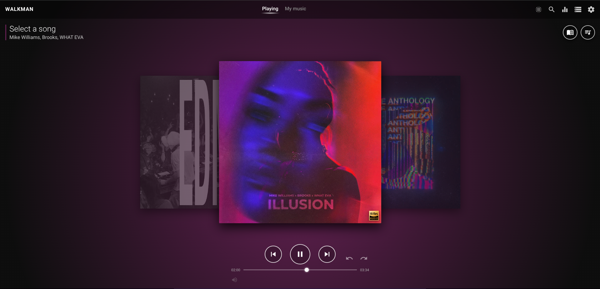
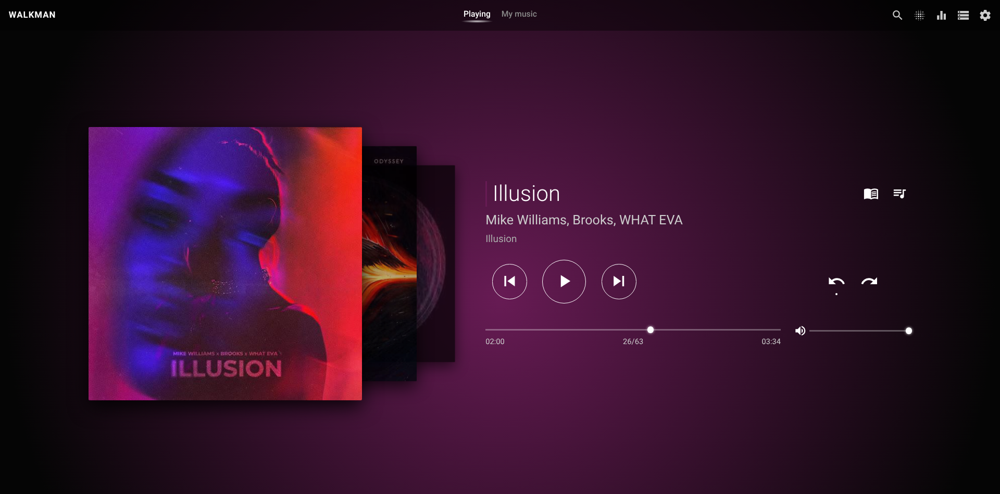
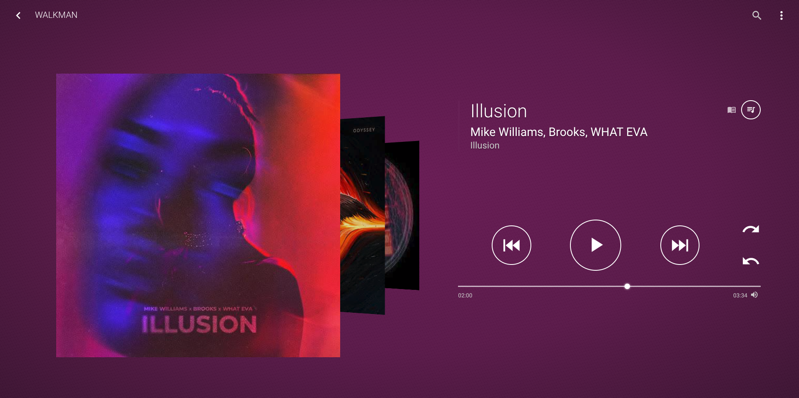
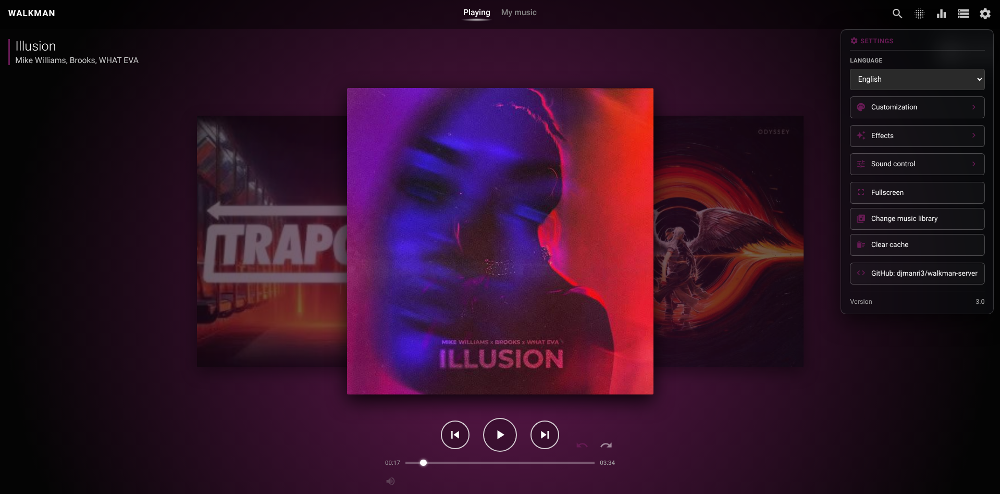
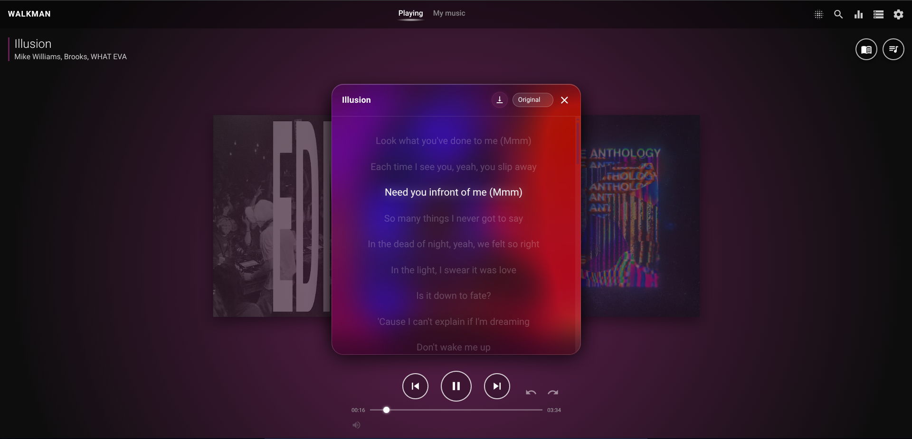
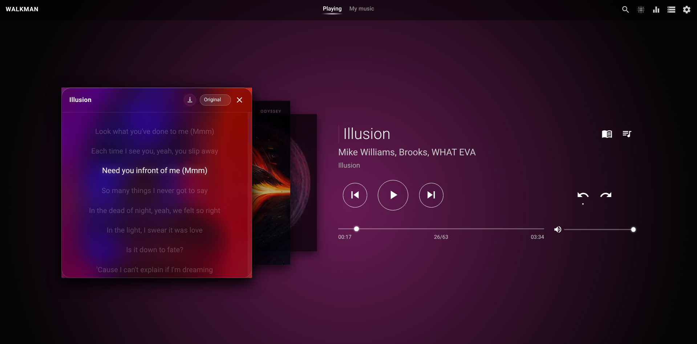
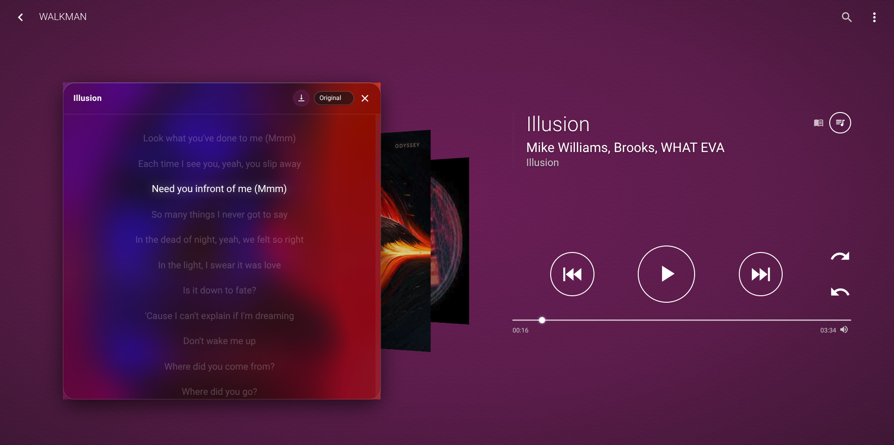

# walkman-server
Small music player for Emby, Jellyfin, and Plex with the style of the Walkman app of Xpetia NXT series

# Access without install on presmise
You can access in this link: https://djmanri3.github.io/walkman-server/

## Recommended Web Browsers
### Windows
- Google Chrome
- Microsoft Edge
- Firefox
- Zen Browser
- Samsung Internet Browser
  
### Android
- Google Chrome
- Google Chrome (WebApp)
- Samsung Internet Browser
- Samsung Internet Browser (WebApp)

### MacOs
- Firefox
- Zen Browser
- Chrome
- Safari (only rewind and ast-forward)

### iOS and iPadOS (iPad and iPhone) [NO VIEW ALBUM ART]
- Safari (WebApp) (not show album art but gets next and previous buttons)
- Google Chrome (not button to next or previous song, only advance or rewind 30 seconds)
- Brave (not button to next/previous song, only advance or rewind 30 seconds)
- Firefox (not button to next/previous song, only advance or rewind 30 seconds)
- Opera Browser (not button to next/previous song, only advance or rewind 30 seconds)

# How to install on premise
- Do you need to install Docker and docker-compose
- Only download docker-compose.yaml file and exec in the same folder you donwload it
```
docker-compose up -d
```
- And acces to <ip server or locahost>:8081

# Features
- Native equaliser with 5 bands [not working on iPad and iPhone]
- Open Bass: an independently written bass effect using public DSP equations and runtime-calculated coefficients. Uses AudioWorklet on HTTPS/localhost and the same DSP in compatible mode over plain HTTP, with a final anti-clipping guard. [Design, validation and provenance](docs/open-bass.md). Audio effects remain disabled on iPad and iPhone.
- Add equaliser space (VPT) with 3 profiles [not working on iPad and iPhone]
- Add song visualizer
  - Anillos pulsantes
  - Barras de frecuencia
  - Onda estéreo
  - Ondas PS3
  - Cosmic Flow
  - Particulas del álbum
  - Bloques ritmicos
- Fix search
- Add buttons of playlist, repeat, repeat playlist and shuffle
- View in carousel mode
- Background colour adapts to album cover
- Add install on smartphone with web app
- Compatible with medIa widget browser 
- Add connection with Emby, Jellyfin, Plex AND LOCAL!!!
- FIX LIST ALBUM COVERS ON EMBY SERVERS!!!!!
- Add Side Show of albums on tab My Music (can be disable on settings)
- Add reorder song on play queue
- Fix auto-close equaliser when clic or touch on another part
- Fix clean cache
- Add settings to resize some things
- Fix add song by Album on play queue
- Add banner when adding local music on Android to wait ready
- Update lib of get album color
- Add a glow adjustment based on the song's rhythm on settings.
- Add option on settings to simulate LED effect of Xperia SP LEDs
- Add option to view lyrics, lyrics get from service LRCLIB and translated into your language use api.memory.translated.net
- Fix connection to Plex servers and fix getting data from them (Songs, Artists, Albums and Playlists)
- Add menu when clic or touch on an album cover is playing with these options:
  - Search song on YouTube
  - Search album on Google
  - Search artist on Google
  - More songs from this artist
- Add config parameters on docker-compose
  - DEFAULT_LANGUAGE: English, Español, Français, Deutsch, Italiano or Português
  - DEFAULT_SERVER_TYPE: Emby, Jellyfin, Plex or Local
  - DEFAULT_SERVER_URL: your server URL
- Add media controls with keyboard
  - r: repeat song mode
  - s: random song mode
  - ->: next song
  - <-: previous song
  - space bar: play/pause
- Enable or disable auto scroll on lyrics
- Redesign settings menu
- Add hi-res icon when music is hi-res
- Application security improved

### Version 3.0
- Add icon when song is Hi-Res audio (can be disable on settings)
- Favorites on My music tab added
- Added can add song to playlist
- Add independent Open Bass DSP with HTTP support and output limiting
- Add more visualizer effects
- Add new Classic theme
- Refine Xperia SP light bar with paired pulses and adaptive album color
- Add interactive album swipe animations for Modern and Classic themes
- Harden metadata rendering, cover parsing and service worker caching
- Add show app version in settings and Walkman easter egg ;)
- Center desktop navigation (Playing and My music text) while preserving mobile header layout
- Animate overflowing Playing titles in Modern and Classic themes
- Add images to describe type librarys on My music tab
- Add default image when music haven't album cover
- Add new Z1 theme change all of UI Playing and My Music tab

### Version 3.1
- Add progress bar particles to Modern, Classic and Z1, including the visualizer and Z1 mini-player
- Add album-based or custom particle colors, plus RGB rainbow, color cycle, breathing and wave effects
- Add round and square particle shapes and save effect preferences
- Keep the particle preview running in Settings and smooth animation as playback advances

### Upcoming changes
- Restore server playback after reload, including the current track, position and playing/paused state
- Improve Classic controls on narrow windows and activate the compact layout at 640px
- Add translated update notices with Update and Later actions, preserving settings
- Detect installed and available cache revisions on hosted installations and local file bundles

### App update notices
When hosted over HTTP(S), the app checks `version.json` without using the cached response on each page load. It compares the installed cache revision with the available one and shows an update notice in the selected language. **Update** activates the downloaded service worker, removes obsolete app caches and reloads; server configuration, preferences and local-library storage are preserved. **Later** hides the notice until the next page load. Offline checks leave the current installation unchanged.

For each deployment that changes app files, increment the `walkman-v…` cache revision in `sw.js`, `version.json` and the `walkman-cache-version` metadata in `index.html`. Set the display version in `version.json`, the `walkman-version` metadata and the Settings/About labels when releasing a new app version. Deploy these files together.

When opened with `file://`, the app compares the bundle version embedded in `index.html` with the last accepted local version. The first load establishes a baseline; replacing the files with a newer bundle and reloading shows the notice. Update reloads that local bundle without erasing settings. Local mode cannot detect or download a newer hosted release and does not use service workers.

# Bugs
- Tell me :)

# Screenshots

## Player
### Theme Modern


### Theme Classic


### Theme Z1


### Settings


## Player search


## Lyrics
### Theme Modern


### Theme Classic


### Theme Z1


## Ecualizer
### Clear bass


### Spatial Equaliser (VTP)


## Visualizer


## Library
### Theme Modern and Classic


### Theme Z1


### Songs
### Theme Modern and Classic


### Theme Z1


### Artists
### Theme Modern and Classic


### Theme Z1


### Albums
### Theme Modern and Classic


### Theme Z1


### Playlist
### Theme Modern and Classic


### Theme Z1


### Inside of playlists
### Theme Modern and Classic


### Connect to server or local
#### Emby


#### Jellyfin


#### Plex


#### Local

